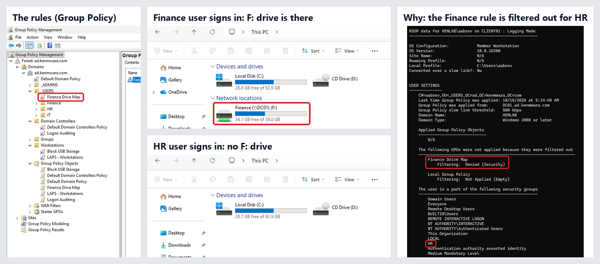

<!-- banner --><a href="https://github.com/kenmwara"></a>

# Active Directory home lab

A pretend company, running entirely on my own laptop. No cloud, fully on-premises: a **Windows Server 2025 domain
controller**, a **Windows 11 PC joined to the domain**, **999 user accounts** created with PowerShell, and **five Group
Policies**, each one proven on the client.

Active Directory (AD) is the directory most companies use to manage who can sign in, to which computers, and with what
rules. Group Policy is how those rules get pushed out. This lab is where I practise that work end to end.

- **Host:** Windows 10 Pro laptop, Hyper-V (Windows' built-in virtualisation), two virtual machines.
- **DC01:** Windows Server 2025. Forest `ad.kenmwara.com` (NetBIOS name `KENLAB`), running AD DS, DNS, DHCP and NAT
  routing (it hands out addresses and is the only way out to the internet).
- **CLIENT01:** Windows 11 Enterprise on an isolated lab network. Gets its address from DC01, reaches the internet only
  through DC01, joined to the domain.
- **Directory:** 999 users, department OUs (IT, Finance, HR), a security group per department, and a separate admin
  account in `_ADMINS`.
- **Group Policy:** password and lockout rules, Windows LAPS, a USB storage block, a Finance-only network drive, and
  logon auditing.
- **AI helpdesk agent:** Claude Code on CLIENT01 with seven AD tools of my own over MCP, kept in line by AD
  delegation, a confirmation step and DC01's own audit log ([section below](#the-ai-helpdesk-agent-mcp)).
- **Built:** 16 to 18 October 2026; the agent 21 to 24 October.

---

## Screenshots

<p>
  
</p>

*The rule, the result, and the proof: the Finance drive reaches Finance and nobody else, and `gpresult` on the HR user says
exactly why. Every milestone has a full screenshot in [`screenshots/`](screenshots/).*

## The network

```
 Laptop (Windows 10 Pro, Hyper-V)
 ├── "Default Switch"  (Hyper-V's built-in NAT to the home internet)
 │        │
 │     [ DC01 ]  Windows Server 2025
 │      NIC 1 "INTERNET"  → Default Switch (automatic address)
 │      NIC 2 "LABNET"    → LabNet, static 172.16.0.1/24
 │      Roles: AD DS + DNS, DHCP, Routing (NAT)
 │        │
 └── "LabNet" private switch  (VMs only: no host, no internet of its own)
          │
       [ CLIENT01 ]  Windows 11 Enterprise
        NIC → LabNet, address from DC01's DHCP (172.16.0.100–200),
        internet through DC01's NAT, joined to ad.kenmwara.com
```

## What I built, step by step

| # | Milestone | Proof |
|---|---|---|
| 1 | The LabNet switch and both VMs, created by [`scripts/create-lab-vms.ps1`](scripts/create-lab-vms.ps1) (Generation 2, CLIENT01 with a virtual TPM for Windows 11) | [01](screenshots/01-host-vms-created.png) |
| 2 | DC01 renamed, two network cards named, static lab address | [02](screenshots/02-dc01-renamed-checkpoint.png) |
| 3 | AD DS installed and the forest created: `ad.kenmwara.com`, `KENLAB`, Windows2025Domain | [03](screenshots/03-domain-created.png) |
| 4 | My own Domain Admin account, `a-kkariuki`, in `_ADMINS` | [04](screenshots/04-admin-account-created.png) |
| 5 | DHCP authorised and the 172.16.0.100–200 scope active | [05](screenshots/05-dhcp-scope-active.png) |
| 6 | 999 users created by script (1,003 accounts with the built-ins and my admin) | [06](screenshots/06-users-created-1003.png), [09d](screenshots/09d-user-count.png) |
| 7 | Routing and Remote Access running as NAT | [07](screenshots/07-nat-running.png) |
| 8 | CLIENT01 gets 172.16.0.100 from DC01 | [08](screenshots/08-client01-dhcp-address.png) |
| 9 | CLIENT01 joins the domain; a domain user signs in, authenticated by DC01 | [09](screenshots/09-client01-joined-domain.png), [09b](screenshots/09b-domain-logon.png) |
| 10 | CLIENT01 reaches the internet through DC01 (first hop 172.16.0.1) | [09c](screenshots/09c-nat-internet.png) |
| 11 | Company structure: `_USERS\IT`, `Finance`, `HR`, a security group each, CLIENT01 moved to `Workstations` | [10](screenshots/10-ou-structure.png), [11](screenshots/11-client01-in-workstations.png) |
| 12 | Five Group Policies built and linked | [12](screenshots/12-gpmc-overview.png) |

## The five Group Policies

Each one was applied with `gpupdate /force` and then proven on CLIENT01 or DC01.

| GPO | Linked to | What it does | Proof |
|---|---|---|---|
| Password and account lockout (Default Domain Policy) | the domain | 14-character complex passwords, 24 remembered; 5 bad attempts lock the account for 15 minutes | `Search-ADAccount -LockedOut` finds the test user locked: [13](screenshots/13-lockout-policy.png), [13b](screenshots/13b-password-policy.png), [14](screenshots/14-account-locked.png), [14a](screenshots/14a-client-throttle.png) |
| Windows LAPS | `Workstations` | Rotates CLIENT01's local Administrator password and stores it in AD, readable only by Domain Admins | `Get-LapsADPassword CLIENT01` shows a fresh rotation, with the password kept masked: [15](screenshots/15-laps-password.png) |
| Block USB storage | `Workstations` | All removable storage classes: deny all access | `Deny_All = 1` under `RemovableStorageDevices` on CLIENT01: [16](screenshots/16-usb-block.png) |
| Finance drive map | `_USERS`, security-filtered to Finance | Maps `\\DC01\Finance` as `F:` | Finance user gets `F:`, HR user doesn't, `gpresult` shows *Denied (Security)*: [17](screenshots/17-finance-gets-F.png), [18](screenshots/18-hr-no-F.png), [20](screenshots/20-gpresult.png) |
| Logon auditing | `Domain Controllers` | Advanced Audit Policy: Logon, success and failure | Event IDs 4624 and 4625 in DC01's Security log: [19](screenshots/19-logon-audit-4624-4625.png) |

## What broke, and how I fixed it

### The drive map that quietly said "nobody"

The first version of the Finance drive used **item-level targeting**: a filter inside the drive-map setting that says
"only if the user is in KENLAB\Finance". I signed in as my Finance test user and got no drive.

Every check came back green. `whoami /groups` showed Finance in the user's sign-in token. `gpresult` said the GPO had
applied. The share and its permissions were fine. An hour later I removed the targeting completely, and the drive
appeared at once. So the filter itself was the fault, even though nothing reported an error.

The fix was to scope the whole GPO instead:

1. **Security Filtering** (Group Policy Management → the GPO → Scope tab): remove *Authenticated Users*, add *Finance*.
2. **Give Authenticated Users plain Read** (Delegation tab → Advanced: Read, not Apply). Since Microsoft's MS16-072
   update, Windows fetches user policies using the computer's own account, so a GPO filtered to a user group alone breaks
   for everyone, Finance included.

With both in place, Finance gets `F:`, and an HR user's `gpresult` lists *Finance Drive Map, Filtering: Denied
(Security)*. The lesson I'll keep: when every check says it's fine and it still isn't, stop trusting the checks. Remove
one piece on purpose and watch what changes.

### Smaller traps

- **Extending the schema for LAPS needs Schema Admins, not Domain Admins.** `Update-LapsADSchema` failed with
  "insufficient access rights". After adding my admin to Schema Admins I had to sign out and back in, because group
  membership is baked into the sign-in token.
- **Hyper-V's Enhanced Session is a Remote Desktop sign-in.** A domain user got "you need the right to sign in through
  Remote Desktop Services" until `KENLAB\Domain Users` was added to CLIENT01's local Remote Desktop Users group.
- **The "Press any key to boot from CD" prompt lasts about 5 seconds.** Miss it and the VM reports "the boot loader
  failed": reset the VM and tap Space straight away.
- **DC01's internet-facing card must not register in the domain's DNS**
  (`Set-DnsClient -RegisterThisConnectionsAddress $false`), or clients sometimes look for the domain controller on the
  wrong network.

## The AI helpdesk agent (MCP)

Since 24 October the lab has an AI helpdesk agent. It's Claude Code on CLIENT01, signed in to Windows as its own domain
account, `KENLAB\ai-operator`, and it can only use seven tools I wrote and connected over MCP (Model Context Protocol,
the standard way AI tools plug into other systems). It can look people up, unlock an account, add someone to a group and
disable an account.

<p>
  
</p>

**Where it lives**

- **The MCP server, `admcp`, runs on CLIENT01 next to Claude Code.** Claude Code starts it as a child process and talks
  to it over stdio, so it listens on no network port. It runs as the same `ai-operator` account and holds no passwords or
  keys of its own.
- **Each tool is one fixed PowerShell script.** The server hands the arguments over as JSON on stdin (the agent's text
  never lands on a command line), the script checks every value and calls the ActiveDirectory module, which reaches DC01
  over AD Web Services (TCP 9389) with `ai-operator`'s Kerberos ticket.
- **The model is in the cloud, the tools aren't.** Claude Code sends prompts and tool results to Anthropic's API through
  DC01's NAT. The model never gets a route to AD of its own.
- **The code is written on the host** and copied into CLIENT01 with `Copy-VMFile`, so no Git credentials sit on the lab.

**What keeps it in line (none of it is the model)**

1. **AD decides what it may touch.** The group `AI-Operators` has write rights on users in `_USERS` and groups in
   `Groups`, set with `dsacls`, and nothing else. Outside those, AD answers "Insufficient access rights to perform the
   operation", and the agent gets that text word for word.
2. **A person approves what it can't undo.** Claude Code asks me before every `ad_disable_account` call. Admin-only
   managed settings load `admcp` and nothing else, and deny the shell and file writes.
3. **DC01 keeps its own record.** Advanced Audit writes 4728 (added to group), 4725 (disabled), 4767 (unlocked) and 5136
   (object changed) for every change, each one "by ai-operator", and a detector task reads them every 5 minutes.

Setting it up was the first test. Asked to list every tool it had, the agent named 38, and only seven were mine: the rest
came built into the program around it. Admin-only settings brought that down to 16. The first live run is the video in
[this LinkedIn post](https://www.linkedin.com/feed/update/urn:li:activity:7519965993448849408/).

The agent's code, the 13-test red-team campaign and every finding are in their own repo:
**[Securing an Active Directory Agent](https://github.com/kenmwara/securing-ai-agents-ad)**.

## By the numbers

| Part | Lines | What it is |
|---|---|---|
| PowerShell that builds the lab | 89 | 46 in [`scripts/create-lab-vms.ps1`](scripts/create-lab-vms.ps1) (the Hyper-V switch and both VMs) and 43 in the code blocks of [`BUILD.md`](BUILD.md) (the domain, DNS, DHCP, NAT, OUs, groups and the domain join). The 999 users come from Josh Madakor's script, which isn't copied here (see Credits) |
| Build guide ([`BUILD.md`](BUILD.md)) | 177 | every step, the commands I ran, and what breaks and why |
| This README | 181 | |
| Screenshots | 26 | one per milestone and per Group Policy proof, plus 5 composites and the agent diagram in [`images/`](images/) |

The five Group Policies were built in Group Policy Management, not in script. Behind this repo there is also a longer
private Hyper-V guide (226 lines), the tooling that captured the screenshots and laid out the images (292 lines of
PowerShell and Python), and the post drafts. All in: about 950 lines of text, 338 of them code, plus 66 images and PDFs.

## Build it yourself

[BUILD.md](BUILD.md) has every step with the commands I ran, plus a table of what breaks and why.

## Credits

The base design follows Josh Madakor's *How to Setup a Basic Home Lab Running Active Directory* (VirtualBox, Windows
Server 2019, Windows 10), and the 999 users come from his public script,
[joshmadakor1/AD_PS](https://github.com/joshmadakor1/AD_PS). I moved the lab to Hyper-V, Windows Server 2025 and
Windows 11, and added the department structure and the five Group Policies.

*Lab only: every account and password here lives on an isolated lab network that exists on one laptop. I also told the
5 AM story of the drive map [on LinkedIn](https://www.linkedin.com/feed/update/urn:li:activity:7517614274115190784/).*
